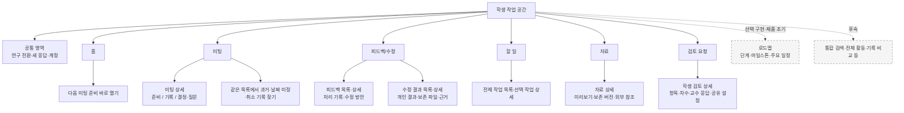
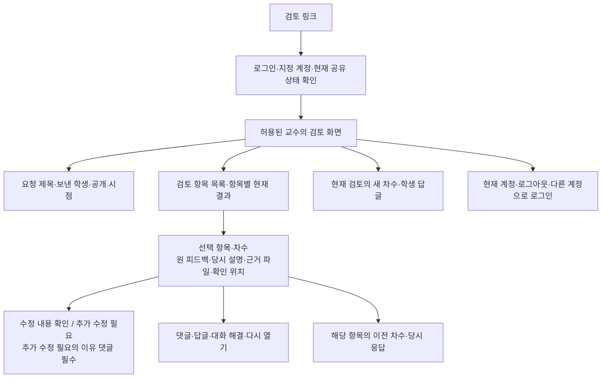

# RMS 정보 구조·화면 목록

수정일: 2026-11-03 · 상태: 화면 설계를 위한 IA 작성 기준안

기준 문서: [PRD](prd.md), [기능명세서](functional-specification.md), [유저 플로우](user-flow.md), [수업 시연 기준](../deployment.md).

이 문서는 정보를 어느 메뉴와 화면에서 찾고 어떤 행동을 같은 화면에서 수행할지 정한다. 순차 행동과 저장 조건은 유저 플로우·기능명세서를 따른다. 화면ID는 논리적 화면·영역의 식별자이며 ID마다 별도 페이지를 구현하는 뜻은 아니다. 메뉴 이름·탭·레이아웃·주소는 이번 설계 기준안이며 사용자 개별 확정이나 구현 완료로 취급하지 않는다.

## 1. 구조를 정한 기준

- 학생의 현재 연구를 작업 범위로 삼고 홈에서 다음 미팅 준비를 바로 연다. 다음 미팅 준비를 별도 상위 메뉴로 복제하지 않고 미팅 상세의 준비 영역을 재사용한다.
- 학생의 개인 수정 결과는 피드백과 함께 찾고 교수에게 보낸 검토 요청은 별도 메뉴에서 찾는다. 결과를 저장하려고 공유 기능부터 사용할 필요가 없게 한다.
- AI는 메모·피드백·준비 문서의 필요한 자리에서 연다. 별도 AI 채팅 메뉴나 항상 열린 대화창을 기본으로 두지 않는다.
- 자료·작업·질문은 원본 하나를 여러 기록에서 참조한다. 서로 다른 화면에 나타나도 다시 입력하거나 다른 사본을 만들지 않는다.
- 교수는 검토 링크로 해당 요청에만 접근한다. 학생의 메뉴·연구 목록·전체 할 일·개인 메모를 교수 화면에 붙이지 않는다.
- 시연 필수와 제품의 초기 설계·후속 기능을 구분한다. 미구현 메뉴를 동작하는 화면처럼 표시하지 않는다.

## 2. 학생의 메뉴와 화면 계층

상단에는 연구 전환·현재 위치·새 응답·계정 메뉴를 두고 왼쪽에는 현재 연구의 주요 메뉴를 둔다. 좁은 화면의 메뉴 배치는 화면 설계에서 정하며 정보의 소속과 권한은 유지한다.

| 상위 메뉴 | 내부 정보·하위 이동 | 대표 진입 행동 | 시연 범위 |
|---|---|---|---|
| 홈 | 다음 미팅과 보여줄 결과, 남은 작업·질문, 새 교수 응답, 등록된 가까운 마감 | 준비 열기, 미팅 기록 남기기, 해당 작업·질문·검토 항목 열기 | 필수. 마감 요약은 일정 기능이 구현된 경우 표시 |
| 미팅 | 같은 목록의 예정·과거·날짜 미정·취소 미팅, 미팅 상세 | 새 미팅, 준비·기록·결정·질문 열기 | 필수 |
| 피드백/수정 | 피드백과 수정 결과를 두 하위 항목으로 구분 | 피드백 추가·처리·수정 방안, 개인 결과 작성·근거 등록 | 필수. 반복 묶음 편집은 선택 구현 |
| 할 일 | 미팅에 포함하지 않은 작업까지 포함한 전체 목록과 작업 상세 | 직접 추가, 상태·기한 변경, 준비에 포함, 결과 정리 | 필수 |
| 자료 | 자료 목록·분류·선택 자료·보존 버전·외부 참조 | 자료 등록, 미리보기, 기존 버전 선택·새 버전 추가 | 필수. 시연은 PDF 우선 |
| 검토 요청 | 학생이 만든 요청 목록과 요청·항목·차수 상세 | 기존 결과로 검토 구성, 공개 미리보기, 링크 복사, 응답 확인·재확인 | 필수 |
| 로드맵 | 단계·마일스톤·공식 마감·개인 목표 | 직접 등록·수정·진행 기록 | 제품 초기 기능이나 이번 시연의 선택 구현. 미구현이면 메뉴 숨김 |

첫 진입에서 연구가 없으면 연구 선택·생성으로 안내한다. 연구가 있으면 선택한 연구 홈을 연다. 준비할 미팅이 없으면 기존 미팅을 선택하거나 날짜 미정 미팅을 만들 수 있게 한다. 홈에서 준비 대상으로 고른 미팅을 표시하는 방식은 작성 기준안이며 여러 미팅의 준비·조회 자체를 제한하지 않는다.

## 3. 교수 검토의 별도 정보 구조

- 학생 소유자와 허용 교수는 같은 검토 링크에서 각자의 권한에 맞는 화면을 본다. 주소나 화면의 역할 선택값으로 권한을 부여하지 않는다.
- 교수에게는 받은 검토 링크를 여는 경로를 안내하며 일반 접속만으로 교수용 검토 목록이나 학생 대시보드를 제공하지 않는다. 링크 안내는 A01의 보조 안내로 둔다.
- 요청에 여러 항목이 있어도 교수 결과는 항목·차수별로 표시한다. 요청 전체의 승인·재검토 상태를 새로 만들지 않는다.
- 학생 소유자에게는 재확인·공유 설정·원래 개인 기록으로 돌아가기를 보여준다. 교수에게는 본인 결과·댓글 행동만 허용한다.
- 교수는 공유한 근거 파일 전체를 열 수 있다. 확인 위치는 읽기 안내이며 해당 페이지만 공개하는 권한 설정이 아니다.
- 공개한 원문 발췌와 학생의 비공개 원문 전체를 구분한다. 개인 메모로 이어지는 링크를 교수에게 자동 제공하지 않는다.

## 4. 화면 목록

범위의 의미는 다음과 같다. 필수는 D01~D06의 실제 수행·기본 조회에 필요한 영역, 선택은 제품 초기 기능 중 시연 뒤에 구현할 수 있는 영역, 시연 제외는 제품 흐름에 있으나 이번에는 사전 준비로 대신하는 영역이다. 모든 화면은 현재 설계 기준이며 실제로 구현된 화면은 아니다.

### 공통 진입

| ID | 화면·영역 | 주요 정보 | 주 행동·진입·복귀 | 범위 |
|---|---|---|---|---|
| A01 | 로그인 | 현재 계정 확인, 로그인 입력·실패, 원래 진입 목적 | 학생 작업 진입은 S01·S02로, 검토 링크 진입은 S13·R01의 요청·항목·차수로 복귀. 다른 계정 로그인도 같은 위치를 유지 | 필수 |
| A02 | 접근 불가 | 내용 없는 안내, 현재 로그인 상태 | 다른 계정으로 로그인·종료. 요청 제목·파일·발췌는 노출하지 않음 | 필수 |
| A03 | 이메일 확인 | 확인 대기·실패·완료 | 필요한 확인 후 원래 위치로 복귀. 시연 계정은 준비 단계에서 확인 | 시연 제외·조건부 접근 차단 안내는 필수 |
| A04 | 가입 | 필요한 가입 입력·결과 | 일반 제품의 가입 흐름. 시연은 사전 발급 계정 사용 | 시연 제외·제품 초기 설계 유지 |

### 학생 작업

| ID | 메뉴·계층 | 화면·영역 | 주요 정보 | 주 행동·진입·복귀 | 범위 |
|---|---|---|---|---|---|
| S01 | 공통 | 연구 선택·생성 | 내 연구·현재 연구, 생성 입력, 활성·보관 구분 | 일반 접속·연구 전환에서 진입. 생성·선택 후 연구 홈. 보관·복원은 목록 안의 추가 행동 | 선택·생성 필수 / 보관·복원 선택 |
| S02 | 홈 | 현재 연구 홈 | 준비 대상 미팅·결과 목표, 남은 작업·질문, 새 교수 응답, 등록 일정 | 준비 열기는 S04, 작업은 S09, 질문은 S04의 해당 항목, 교수 응답은 S13의 해당 항목·차수·대화로 이동 | 필수 |
| S03 | 미팅 | 미팅 목록 | 이름·일시·날짜 미정·기록 상태, 과거·취소 미팅 | 미팅 추가, 이름·날짜·상태로 찾기. 과거 미팅도 같은 S04로 이동 | 필수 |
| S04 | 미팅 > 선택 미팅 | 미팅 상세 | 준비 / 기록 / 결정·질문 | 홈·목록·연결 질문에서 진입. 준비 작업·자료·질문과 당시 기록을 같은 미팅 안에서 조회 | 필수 |
| S05 | 피드백/수정 > 피드백 | 피드백 목록 | 내용·출처·학생 처리 상태·연결 작업·관련 교수 결과를 구분 | 직접 추가·원문에서 가져오기·필터, S06으로 이동. 반복·미해결 보기와 묶음은 같은 메뉴의 추가 보기 | 목록·필터 필수 / 반복 묶음 편집 선택 |
| S06 | 피드백/수정 > 피드백 | 피드백 상세 | 내용·당시 발췌·출처, 학생 처리 기록·개인 메모, 수정 방안, 관련 작업·수정 결과·검토 | 방안 직접 작성·선택적 AI·저장, 할 일로 만들기, 수정 결과 작성, 기존 검토 열기. 개인 메모는 공유하지 않음 | 필수 |
| S07 | 피드백/수정 > 수정 결과 | 개인 수정 결과 목록 | 제목·처리 설명·연결 작업·피드백·근거, 검토에 사용한 관계 | 결과 작성·기존 결과 열기. 미공유 결과도 목록에 남음 | 필수 |
| S08 | 피드백/수정 > 수정 결과 | 개인 수정 결과 상세 | 실제 처리 설명·작업·피드백·보존 파일·위치·개인 저장본, 공유한 차수로의 연결 | 작성·수정·근거 선택, 교수 검토 준비 선택. 공유 전에 파일이 부족해도 개인 결과는 저장 가능 | 필수 |
| S09 | 할 일 | 전체 작업 목록·선택 작업 상세 | 제목·출처·진행·기한, 연결 피드백·미팅, 결과 | 추가·상태·기한 저장, 준비에 포함, 결과 정리. 상세는 목록과 같은 작업 영역에서 열 수 있음 | 필수 |
| S10 | 자료 | 자료 목록 | 이름·유형·파일/외부 참조·최근 수정, 분류·보관 여부 | 자료 등록·유형 필터·정렬, S11로 이동. 보관 관리는 목록의 추가 행동 | 목록·등록 필수 / 보관 관리 선택 |
| S11 | 자료 > 선택 자료 | 자료 상세·미리보기 | 선택 보존 버전·파일·페이지, 버전 목록·진행 내용·미팅 제출 관계, 외부 주소 | PDF 미리보기·버전 선택·새 버전 등록·원본 열기. 미팅·결과에서 시작했다면 그 편집 위치로 돌아가 연결 | 필수 |
| S12 | 검토 요청 | 내가 만든 검토 요청 목록 | 제목·허용 교수·공유 상태·공개 시점, 항목별 현재 결과 요약 | 기존 결과를 골라 요청 구성, 기존 요청 선택 후 S13. 요청 전체의 승인 상태는 없음 | 필수 |
| S13 | 검토 요청 > 선택 요청 | 학생 검토 상세 | 요청·공개된 항목, 항목별 최신·이전 차수·설명·파일·교수 결과·댓글, 공유 상태 | 링크 복사·응답 조회·답글·항목별 재확인·공유 설정. 개인 결과를 고쳐도 보낸 차수는 바뀌지 않음 | 필수 / 주소 변경·공유 관리도 접근 규칙 유지 |
| S14 | 로드맵 | 단계·마일스톤·주요 일정 | 단계·완료 기준·진행·연결 기록, 공식 마감·개인 목표·출처·시각·시간대 | 직접 입력·일정 수정·대표 집중 단계 변경. 자료·작업·피드백의 원본을 연결 | 선택·제품 초기 |

### 교수와 공통 새 응답

| ID | 화면·영역 | 주요 정보 | 주 행동·진입·복귀 | 범위 |
|---|---|---|---|---|
| R01 | 교수 검토 | 해당 요청의 항목·차수·보존 설명·파일·결과·댓글 | 링크에서 A01 또는 직접 진입. 항목별 결과·이유 저장, 일반 댓글·답글, 본인 결과 수정 이력, 이전 차수 조회 | 필수 |
| C01 | 새 응답 표시·목록 영역 | 학생은 현재 연구의 새 교수 응답, 교수는 현재 검토의 새 차수·학생 답글 | S02·학생 상단 또는 R01 안에서 진입. 선택한 항목·차수·대화로 이동하고 계정별 읽음 기록 | 필수·독립 메뉴 아님 |

S05~S08의 목록·상세와 S09의 작업 상세는 공통 목록·상세 레이아웃을 사용할 수 있다. S13과 R01은 같은 검토 데이터를 사용하지만 행동 권한이 다르다. 목록에서 시작한 조회는 필터·선택 위치로 돌아가며 관련 기록에서 시작한 편집은 그 기록으로 복귀한다.

## 5. 미팅 상세의 내부 구성

| 탭·영역 | 담을 정보 | 주 행동 | 중복을 피하는 방식 |
|---|---|---|---|
| 상단 공통 | 미팅 이름·일시·날짜/시각 미정·기록 상태 | 일시 변경·취소·취소 되돌리기·기록 시작·마무리 | 날짜와 기록 상태를 구분하고 작업 기한을 자동 변경하지 않음 |
| 준비 | 보여줄 결과, 선택 작업·순서, 보존 자료·외부 참조, 막힌 이유·질문, 선택 준비 문서 | 남은 일에서 재선택·연결·제외, 질문 추가, 필요하면 준비 문서 편집 | 전체 작업은 S09에 두고 준비 탭은 같은 작업의 미팅 연결을 사용 |
| 기록 | 원문 메모·자동 저장 상태, 직접 정리 항목, 필요할 때 여는 AI 영역 | 메모 입력·붙여넣기, 피드백·결정·질문 편집·저장 | 원문과 정리 항목을 구분하고 저장한 피드백을 S06에서 이어 사용 |
| 결정·질문 | 결정 내용·작성 주체·있는 경우의 출처, 미해결·해결 질문과 연결 미팅 | 직접 추가·수정, 질문을 다음 미팅에 연결, 해결·다시 열기 | 준비에 보이는 질문도 같은 질문이며 별도 사본을 만들지 않음 |

새로 준비하는 미팅은 준비 탭, 기록을 찾으러 연 과거 미팅은 기록 탭을 기본으로 여는 방식을 권한다. 질문·원문·준비 문서의 직접 링크로 들어오면 그 위치가 우선이다. 탭을 바꿀 때 미저장 입력·자동 저장 실패를 처리한다. 과거 미팅은 당시 보고 내용과 현재 연결 작업의 상태를 구분한다.

## 6. 별도 메뉴를 만들지 않는 입력·보조 영역

| ID | 영역·형태 기준안 | 여는 위치 | 저장·취소 뒤 위치 |
|---|---|---|---|
| U01 | 연구 생성·이름 입력 대화상자 | S01 | 생성 후 S02, 취소는 기존 연구 목록 |
| U02 | 미팅 생성·일시 변경 대화상자 | S02·S03·S04, 준비 대상 미팅이 없는 작업 연결 | 같은 미팅의 S04 또는 원래 연결 작업. 날짜 미정 생성 가능 |
| U03 | 할 일 초안·작업 편집 영역 | S06·S09·S04 | 작업 저장 후 원래 위치. 미팅 준비에서 시작하면 그 미팅을 유지해 연결 |
| U04 | 자료 추가·기존 자료/버전 선택·새 버전 업로드 | S10·S11·S04·S08 | 등록과 연결을 구분하고 원래 편집 위치로 복귀. 연결만 실패하면 재업로드하지 않음 |
| U05 | 수정 결과 편집 영역 | S06·S09·S07·S08 | S08 또는 원래 연결 위치. 결과 저장 뒤 공유는 선택 |
| U06 | 검토 구성·공개 미리보기 영역 | S08·S12 | 구성과 미리보기를 왕복하며 입력 유지. 링크 생성 성공 후 S13. 복사는 별도 행동 |
| U07 | 선택 항목 재확인·공개 미리보기 영역 | S13의 이미 공유한 항목 | 저장 성공 시 같은 요청의 해당 항목·최신 차수. 취소는 기존 차수 |
| U08 | 허용 이메일·공유 중지·다시 공유 설정 | S13 | 같은 요청 상세에 결과 반영. 실패하면 이전 설정 유지 |
| U09 | 피드백·결정·질문 직접 입력 영역 | S04·S05·S06, 준비 질문 추가 | 원래 목록·항목으로 복귀. 직접 입력에는 없는 원문 관계를 강제하지 않음 |
| U10 | 필요할 때 여는 AI 보조 영역 | S04의 메모, S06의 수정 방안, 구현된 경우 준비 문서 | 선택 범위·후보·근거·가정을 보여주고 같은 편집 영역에서 저장. 닫기·생성 중단·채택 취소 구분 |
| U11 | 준비 문서 편집 영역 | S04 준비 탭 | 같은 미팅의 현재·이전 저장본으로 연결. 직접 편집 가능, 별도 AI 적용·확정 단계 없음 |
| U12 | 남은 일·미배정 작업 선택 영역 | S04 준비 탭 | 같은 미팅에 기존 작업 연결 후 준비 목록으로 복귀. 작업 복제·기한 자동 변경 없음 |
| U13 | 주요 일정 입력·수정 영역 | 구현된 S14 | 같은 일정에 반영. 외부 확정 마감의 날짜·출처를 확인하고 시각 미확인과 시간대를 구분 |

댓글의 결과 선택·필수 이유 입력은 R01의 같은 항목 안에 둔다. 댓글·답글·대화 해결도 해당 대화에서 수행한다. 별도 ‘이유 댓글 화면’, ‘AI 확정 화면’, ‘할 일 이월 메뉴’를 만들지 않는다.

## 7. 정보 연결과 상태 표기

| 정보 | 기준 위치 | 다른 위치에서 보여줄 때의 규칙 |
|---|---|---|
| 원문 메모 | S04 기록 | 파생 피드백의 당시 발췌·위치로 연결. 원문 수정으로 과거 발췌를 덮어쓰지 않음 |
| 피드백 | S06 | 작업·미팅·수정 결과에서 같은 피드백을 연결하고 학생 처리 상태를 별도 표시 |
| 수정 방안 | S06의 방안 영역 | 학생이 고쳐 저장하고 할 일 생성은 선택. 채택 취소가 기존 작업 삭제는 아님 |
| 작업 | S09 | 미팅 준비에는 연결·순서만 추가. 여러 피드백·미팅에서 같은 작업 사용 |
| 결정·질문 | S04 결정·질문 | 다음 준비에 같은 질문을 연결. 해결·다시 열기는 질문 기록에만 적용 |
| 보존 자료 버전 | S11 | 미팅·개인 결과·검토가 특정 버전을 참조. 외부 참조를 보존 파일로 표시하지 않음 |
| 개인 수정 결과 | S08 | 검토 구성에서 기존 설명·근거를 불러오되 공유한 내용은 해당 차수로 고정 |
| 검토 항목·차수 | S13·R01 | 당시 설명·파일·교수 응답을 함께 조회. 최신 차수는 항목마다 다를 수 있음 |

작업은 진행 전·진행 중·완료, 학생 피드백은 처리 전·진행 중·반영 기록 있음·보류·미수정 결정, 교수 결과는 응답 전·수정 내용 확인·추가 수정 필요로 표시한다. 공유 상태는 준비 중·공유 중·공유 중지이며 교수 결과와 구분한다. 질문 해결·댓글 대화 해결·읽음도 각각 별도 표기한다.

예를 들어 한 요청의 A항목이 v3·2차 검토이고 B항목이 v2·1차 검토일 수 있다. 요청 전체를 ‘v3 확인 완료’로 표시하지 않고 각 항목에 근거 파일 버전·차수·교수 결과를 표시한다. 이 예시는 정보 구조를 설명하기 위한 가상 상황이다.

## 8. 주소와 직접 진입 기준안

아래 주소는 프레임워크 선택 전의 제안이며 이미 동작하는 URL이나 API 주소가 아니다. 같은 기록은 한 기준 주소로 열고 탭·항목·차수·댓글 위치를 추가로 식별한다. 식별자는 읽기 권한을 대신하지 않는다.

| 화면 | 제안 경로 | 직접 열 때의 처리 |
|---|---|---|
| A01 | `/login` | 원래 요청 위치를 유지하되 허용된 앱 내부 위치로만 복귀 |
| S01 | `/r` | 계정이 소유한 연구만 표시 |
| S02 | `/r/:researchId` | 현재 연구 소유 권한 확인 |
| S03·S04 | `/r/:researchId/meetings`, `/r/:researchId/meetings/:meetingId` | 선택 탭·질문·원문 위치를 유지하고 해당 미팅이 연구에 속하는지 확인 |
| S05·S06 | `/r/:researchId/feedback`, `/r/:researchId/feedback/:feedbackId` | 선택한 피드백·원문·방안 위치로 이동 |
| S07·S08 | `/r/:researchId/results`, `/r/:researchId/results/:resultId` | 개인 결과와 보낸 검토 차수를 구분 |
| S09 | `/r/:researchId/tasks`, `/r/:researchId/tasks/:taskId` | 목록·상세 레이아웃을 재사용하고 해당 작업을 선택 |
| S10·S11 | `/r/:researchId/materials`, `/r/:researchId/materials/:materialId` | 선택 버전·페이지로 이동. 접근 불가 파일은 열지 않음 |
| S12 | `/r/:researchId/reviews` | 학생이 만든 요청 목록 |
| S13·R01 | `/reviews/:requestId` | 요청 소유 학생 또는 허용 교수로 권한 확인 후 해당 화면 구성. 항목·차수·댓글 위치를 유지 |
| S14 | `/r/:researchId/roadmap` | 실제 구현한 경우에만 메뉴·주소 제공. 일정 선택 위치를 유지 |

화면 안의 피드백·파일·작업 링크와 새 응답도 같은 기준 주소를 사용한다. 직접 링크로 열어도 소속 연구·부모 메뉴·현재 항목을 표시하고 목록 복귀 시 기존 찾기 조건을 유지한다. 권한 확인 전에는 제목·발췌·건수를 보여주지 않는다. 항목이 없어졌거나 현재 열 수 없으면 내용을 노출하지 않는 안내와 허용된 복귀 경로를 제공한다. 연구 전환 시 이전 연구의 선택 항목·AI 입력을 새 연구로 가져오지 않으며 미저장 입력을 처리한 뒤 대상 연구 홈으로 이동한다.

## 9. 학생·교수에게 보이는 정보의 차이

| 정보·행동 | 소유 학생 | 허용 교수 | 비로그인·다른 계정 |
|---|---|---|---|
| 연구 홈·미팅·전체 작업·개인 메모·AI 후보 | 자기 기록 조회·편집 | 노출하지 않음 | 노출하지 않음 |
| 개인 수정 결과 | 자기 저장본 조회·편집 | 공유 차수에 포함된 당시 내용만 | 노출하지 않음 |
| 공유한 항목·파일·이전 차수 | 공유 중지 후에도 자기 이력 조회 | 공유 중이며 지정 계정일 때 해당 검토만 | 내용 노출 없이 로그인·접근 불가 안내 |
| 교수 결과 | 조회만, 대신 입력·수정 불가 | 본인 결과·필수 이유 저장·수정 이력 | 저장 불가 |
| 허용 대화의 댓글·답글 | 작성·조회·해결·다시 열기 | 작성·조회·해결·다시 열기 | 접근 불가 |
| 공유 구성·재확인·계정 허용 변경 | 학생만 수행 | 수행 불가 | 수행 불가 |

계정은 시연의 별도 세션으로 구분한다. 같은 사람이 학생·교수 시연 계정으로 접속하더라도 화면의 역할 스위치로 권한을 바꾸지 않는다. 파일 열기·다운로드·댓글·응답·AI 실행도 현재 권한을 확인한다.

## 10. 시연에서 제외하거나 늦게 구현하는 위치

| ID | 기능·위치 | 기존 제품 범위 | 시연 처리 |
|---|---|---|---|
| X01 | 통합 검색·유형별 결과 | 1.4 후속 | 상단에 동작하지 않는 통합 검색창을 두지 않음. 초기에는 각 목록의 기본 찾기 사용 |
| X02 | 전체 활동 목록 | 1.4 후속 | 새 응답 표시와 구분. 초기 화면에 자료 등록·일정 변경의 전체 피드를 만들지 않음 |
| X03 | 여러 기록 비교·추가 AI 정리 | 3.1 후속 | 미팅·피드백의 추가 행동으로 확장 가능. 기본 과거 조회는 S03·S04에서 제공 |
| X04 | 일정 역산·재조정 비교 | 5.3 후속 | S14의 추가 행동으로 확장. 미적용 초안이 현재 계획을 바꾸지 않음 |
| X05 | 단계별 준비 가이드 | 5.4 후속 | 단계 상세 안의 후속 영역. 단계 상세 전체를 후속으로 밀지 않음 |
| X06 | 음성·전사·원문 대조 | 8.5 후속 | 정책 확정 뒤 S04의 추가 영역으로 제공. 메모 입력의 선행조건으로 두지 않음 |

## 11. 대표 시나리오와 화면 연결

| 시연 | 주 화면·영역 | 끝난 뒤 확인할 정보 |
|---|---|---|
| D01 학생 로그인·메모 저장 | A01 → S01·S02 → S03·S04 | 같은 연구·미팅의 저장된 메모를 다시 열 수 있음 |
| D02 실제 AI 정리·수정 방안 | S04·U10 → S05·S06·U10 | 당시 발췌와 학생이 저장한 방안, 실행 출처를 구분 |
| D03 할 일·미팅 준비 | S06·U03 → S09 → S04 준비·U12 | 같은 작업·기한·준비 미팅 연결과 보여줄 결과·질문 |
| D04 수정 결과·공유 | S08·U04·S11 → U06 → S13 | v2·설명·위치와 두 항목의 공개 내용, 복사할 링크 |
| D05 교수 항목별 응답 | 링크 → A01 → R01 | 항목별 결과와 필요한 이유가 같은 차수에 저장됨 |
| D06 학생 응답 확인·재확인 | C01 → S13 → S08·U04 → U07 → S13·R01 | 새 항목 차수와 이전 v2·응답, 변경하지 않은 다른 항목 결과 |

## 12. 기능명세서와 IA 대응

기능 번호는 기능명세서의 현재 번호다. 하나의 기능이 여러 화면에서 사용될 수 있고 여러 기능이 같은 화면을 공유한다.

| 기능 | IA 위치 |
|---|---|
| 1.1 연구 자료 통합 관리 | S10·S11·U04 |
| 1.2 문서 버전별 이력 관리 | S11·U04 |
| 1.3 교수 검토 구성·미리보기·링크 생성 | S08·S12·S13·U06 |
| 1.4 통합 검색·전체 활동 | X01·X02 |
| 1.5 연구 생성·전환·보관 | S01·U01·상단 연구 전환 |
| 2.1 피드백 등록·출처·학생 처리 기록 | S04·S05·S06·U09 |
| 2.2 교수 자료 검토·댓글·항목별 응답 | R01·S13 |
| 2.3 반복 피드백·미해결 사항 | S05의 추가 보기·S06 원본 |
| 2.4 작업 마무리·수정 결과·반영 근거 | S07·S08·S09·U05 |
| 2.5 항목별 재확인·이전 차수 | S13·R01·U07 |
| 3.1 여러 기록 비교·추가 AI 정리 | X03 |
| 3.2 AI 수정 방안 제안·비교·선택 | S06·U10·U03 |
| 4.1 할 일 생성·다음 미팅 포함 | S09·S04·U03 |
| 4.2 작업 진행·기한·준비 순서 | S09·S04 준비 |
| 4.3 다음 미팅 준비 목표·자료·문서 | S04 준비·U04·U11 |
| 4.4 미완료 작업 재선택 | S04 준비·U12 |
| 5.1 로드맵·마일스톤·직접 일정 | S14 |
| 5.2 투고 목표·주요 일정 | S14·U13 |
| 5.3 일정 역산·재조정 | X04 |
| 5.4 단계별 준비 가이드 | X05 |
| 6.1 허용 계정 변경·공유 중지 | S13·U08 |
| 6.2 로그인·이메일 확인·지정 접근 | A01~A04·S13·R01 |
| 7.1 연구 현황·다음 행동 요약 | S02 |
| 7.2 기본 목록 찾기·새 응답 | S03·S05·S07·S09·S10·S12·C01·R01 |
| 8.1 미팅 생성·날짜 미정·일정 변경 | S03·S04·U02 |
| 8.2 메모·원문 대조·정리 저장 | S04 기록·U09·U10 |
| 8.3 결정·미해결 질문 | S04 결정·질문·준비·U09 |
| 8.4 과거 미팅 목록·기록 이동 | S03·S04 |
| 8.5 녹음·전사·원문 대조 | X06 |

## 13. 화면 설계로 넘길 때 확인할 항목

- 홈에서 다음 미팅 준비를 바로 열고 날짜 미정 미팅도 준비할 수 있는가.
- 개인 수정 결과를 검토 요청 생성 없이 저장·재조회할 수 있는가.
- 원문·AI 후보·학생 저장·공유한 차수·교수 결과를 다른 정보로 읽을 수 있는가.
- 작업·질문·자료를 여러 위치에서 열어도 같은 원본과 해당 관계로 돌아오는가.
- 일반 댓글과 항목별 결과 저장이 분리되고 추가 수정 필요의 이유는 같은 항목에서 입력하는가.
- 학생·교수의 새 응답이 실제 대상 항목·차수·댓글로 이동하며 권한 없는 내용을 노출하지 않는가.
- 파일 버전과 검토 차수를 구분하고 한 항목만 재확인해도 다른 항목의 결과를 유지하는가.
- 비어 있음·필터 결과 없음·실패·접근 불가·미저장 입력을 서로 다른 상태로 표시하는가.
- 미구현 선택·후속 기능의 메뉴가 실제 동작처럼 보이지 않는가.

이 IA로 화면별 배치와 와이어프레임을 작성할 수 있다. 실제 동작 여부는 구현 후 배포 환경에서 검증하며 현재 주소·화면 수·메뉴 이름이 사용자 검증으로 확정된 것은 아니다.
