# 논문 지도 협업 및 연구 진행 관리 서비스 유저 플로우

수정일: 2026-11-03

기준 문서: [PRD](prd.md), [기능명세서](functional-specification.md). 메뉴·화면 계층·진입 주소는 [IA·화면 목록](information-architecture.md)을 함께 본다.

이 문서는 총괄 흐름과 작업별 세부 흐름으로 구성한다. 도식의 상자는 화면·화면 안의 영역·사용자 행동을 나타내며 상자마다 별도 화면을 만드는 뜻은 아니다. 마름모는 조건 판단이고 화살표의 문구는 진입 조건이나 학생이 선택할 행동이다. 후속 기능은 별도 영역과 점선으로 구분한다. 도식은 설계 기준이며 구현·사용성 검증 결과가 아니다.

## 적용 조건과 범위

| 구분 | 적용 내용 |
|---|---|
| 사용자 확정 | 필요할 때 AI 영역 열기, 수정 방안 후보 제안과 학생 판단, 여러 항목을 한 검토 링크에 묶고 항목별 응답, 교수 계정 로그인·지정 계정 접근, 추가 수정 필요의 이유 댓글 필수, 문서 검토 근거의 보존 파일, 당시 검토 내용 보존과 학생의 명시적 재확인 요청, 다음 미팅 중심 준비 |
| 현재 작성 기준안 | 미완료 작업 수동 재선택, 요청당 교수 계정 한 개, 같은 링크에서 최신·이전 검토 차수 조회, 도식의 세부 화면·영역 구성과 초기·후속 구분 |
| 운영 전 결정 | 실제 인증 제공자·계정 복구, 파일 형식·용량·보존·삭제, 외부 AI 처리 조건, 녹음·전사의 동의·보존 정책 |
| 제외 | 교수의 다수 학생 관리 대시보드, 수정 전 방향을 묻는 별도 검토 기능, 학생 판단 없는 AI 수정·공유·연구 방향 결정 |

학생은 교수의 가입·응답과 전체 로드맵 작성 없이도 메모·피드백·할 일·미팅 준비를 사용할 수 있다. 미팅에서 물을 질문 준비는 유지한다. 이메일·푸시 자동 알림은 초기 범위에 넣지 않으며 검토 링크는 학생이 직접 복사해 전달한다.

## 수업 시연 동선

이번 구현·배포의 목표는 아래 경로를 실제 저장과 Google API 호출로 이어 수행하는 것이다. 세부 제품 흐름은 다음 절에 유지한다. [수업 시연 기준](../deployment.md)의 D01~D06을 우선 구현하며 앱·서버·배포는 구현했으며 실제 Gemini 생성은 키 연결 전이다. 최신 검증 범위는 [2026-11-04 기록](../development.md)을 따른다.

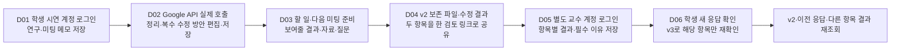

- 시연 계정 사전 발급·허용 목록은 이번 작성 기준이다. 2절의 공개 가입·이메일 확인 전체 흐름을 시연할 필요는 없으며 준비된 계정의 확인 상태와 실제 로그인·접근 권한을 검증한다.
- 역할 스위치만으로 교수 권한을 부여하지 않는다. 학생과 교수는 별도 로그인 세션에서 같은 검토 데이터를 사용한다.
- 문서 AI 구성·로드맵 상세 편집 등은 기존 초기 범위를 유지하되 대표 시연 뒤로 순서를 둘 수 있다. 과거 기록·파일·차수 조회와 실패·취소 복귀는 시연에도 필요하다.
- 시연 필수 AI는 메모 정리와 수정 방안 제안이다. AI가 실패해도 직접 작성·준비를 계속하며 저장된 예시는 실제 API 응답과 구분한다.

## 1. 전체 이동

관련 기능: 1.5, 7.1과 각 작업 기능.

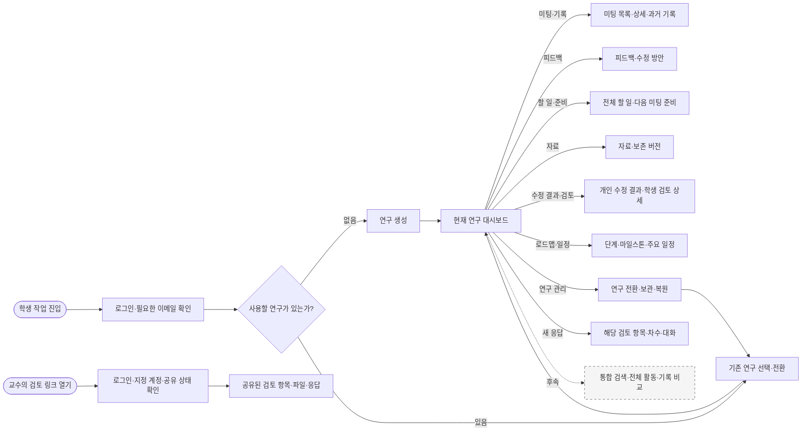

- 빈 연구에는 미팅 기록 남기기·자료 추가를 안내한다. 로드맵이나 교수 검토를 먼저 완료하게 하지 않는다.
- 연구 전환 시 자료·기록·작업·계획과 AI 선택 범위를 함께 전환한다. 보관은 기록 삭제나 공유 중지가 아니며 보관 목록에서 복원할 수 있다.
- 대시보드의 작업·질문·새 응답·일정은 각각 선택한 원래 위치로 이동한다. 교수에게 학생 연구의 전체 대시보드를 제공하지 않는다.

## 2. 로그인과 검토 링크 진입

관련 기능: 6.1~6.2.

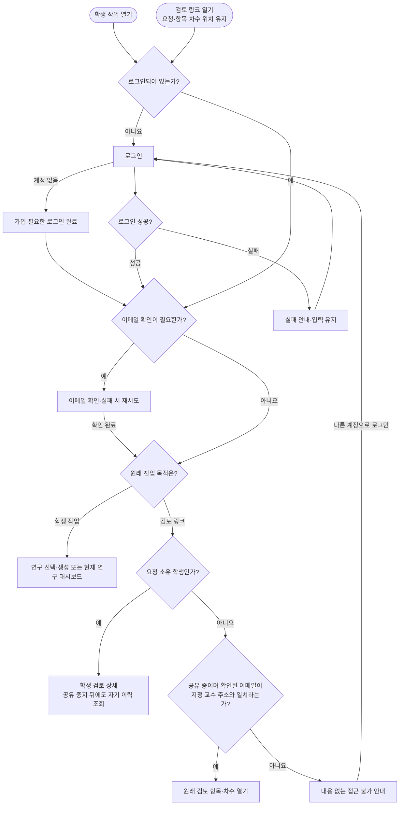

- 인증 중에도 원래 진입 목적을 유지하며 가입·이메일 확인이 끝나면 해당 위치의 권한을 다시 확인한다.
- 접근 불가 화면에는 자료 제목·발췌·파일을 노출하지 않는다. 계정 이메일 일치가 교수 신분 자체를 증명하는 것은 아니다.
- 실제 인증 수단은 운영 전 결정한다. 로그인·이메일 확인은 현재 기능명세서의 화면 기준이다.

## 3. 미팅 생성·기록 정리·결정과 질문

관련 기능: 8.1~8.4, 2.1.

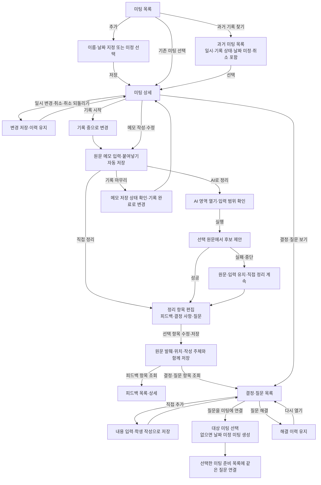

- 기록 마무리 없이도 메모를 저장하고 다른 작업을 할 수 있다. 메모 저장 실패는 입력을 유지하며 저장 성공으로 표시하지 않는다.
- 정리 한 번에 여러 유형의 항목을 저장할 수 있다. 도식의 유형별 연결은 저장한 항목을 조회하는 경로이며 별도 확정 절차가 아니다.
- 같은 발언의 기존 피드백·정리 항목이 있으면 해당 관계를 재사용한다. 직접 작성한 질문에는 없는 원문을 만들지 않는다.
- 날짜가 지나도 기록 완료로 자동 변경하지 않는다. 일시 변경·취소는 연결된 작업·자료·질문이나 개별 기한을 바꾸지 않는다. 취소된 미팅은 기본 준비 대상에서 제외한다.
- 과거 미팅의 당시 자료·준비 문서와 현재 작업 상태를 구분한다. 여러 기록의 비교·추가 AI 정리는 후속 기능이다.

## 4. 피드백과 수정 방안

관련 기능: 2.1, 2.3, 3.2.

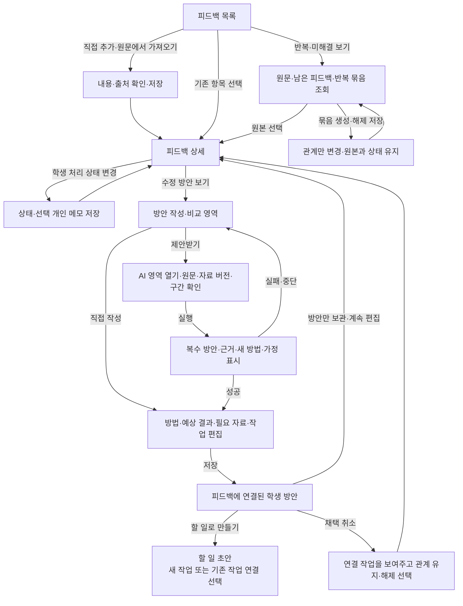

- 학생 처리 상태는 처리 전·진행 중·반영 기록 있음·보류·미수정 결정이다. 작업 완료나 교수 결과가 이 상태를 대신 변경하지 않는다.
- AI 후보 저장은 실제 작업 완료·피드백 반영·교수 확인이 아니다. 직접 작성한 방안과 AI 제안의 출처를 구분한다.
- 방안을 저장해도 할 일은 자동 생성하지 않는다. 학생이 할 일로 만들기를 선택하면 5절의 초안으로 이어진다. 채택 취소도 연결 작업을 자동 삭제하지 않는다.
- 반복 묶음은 학생이 만들거나 해제한다. 비슷한 문장을 자동으로 같은 지적으로 확정하지 않는다.

## 5. 할 일과 다음 미팅 준비

관련 기능: 4.1~4.4.

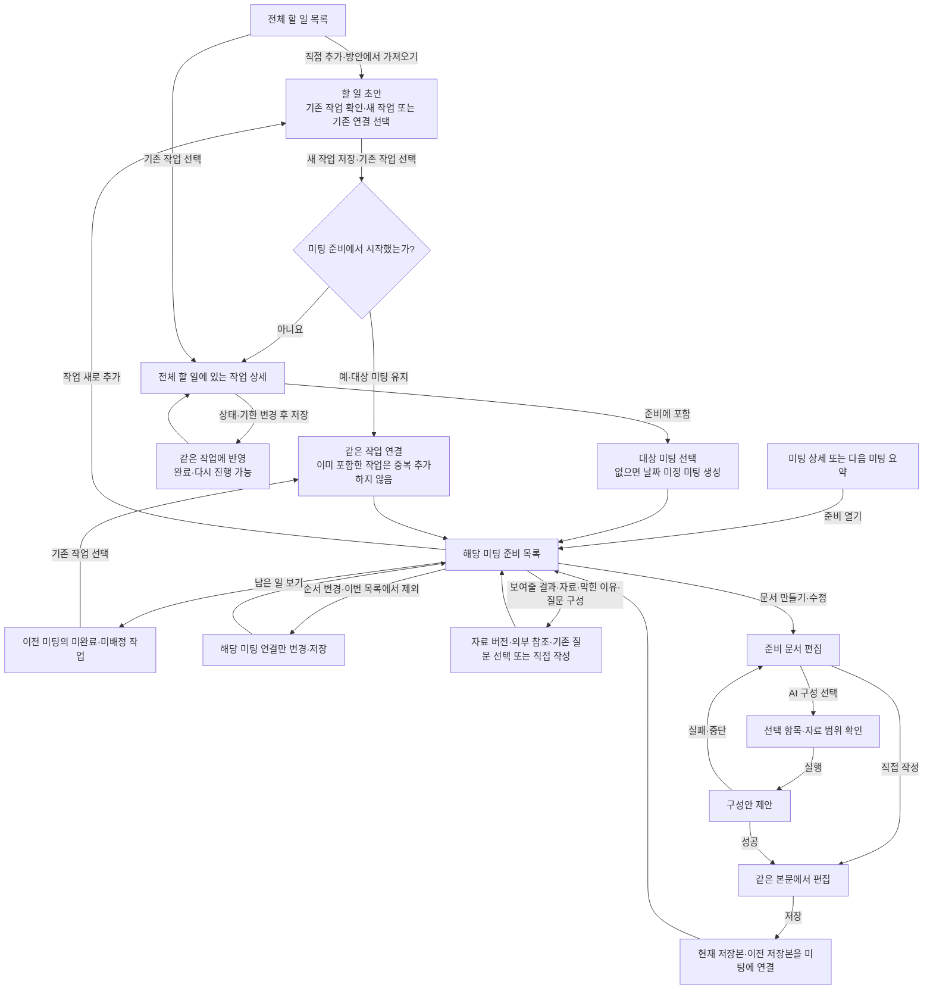

- 작업은 미팅 없이도 저장·진행·완료한다. 작업 저장 뒤 미팅에 포함할지는 선택이며 같은 미팅 안에서 시작하면 대상 미팅을 유지한다.
- 준비 목록과 준비 문서는 구분한다. 작업·자료·질문만 모아 두고 문서를 만들지 않아도 된다. 문서는 미팅ID와 본문이 있어야 저장한다.
- 재선택은 기존 작업을 재사용한다. 이전 미팅 관계·현재 기한·선택하지 않은 작업을 유지하고 준비 순서는 미팅별로 저장한다. 수동 재선택은 현재 작성 기준안이다.
- 미팅을 연기하거나 작업을 목록에서 제외해도 작업 기한은 자동 변경하지 않는다. 기한이 지난 미완료는 지연 표시이며 별도 확정 상태가 아니다.
- 작업 완료 뒤 수정 결과 작성은 선택 행동이다. 파일 등록·피드백 반영·교수 검토 없이 완료만 기록할 수 있다.
- AI 적용·확정·저장을 반복 요구하지 않는다. 직접 작성과 AI 보조 모두 같은 편집 영역에서 저장하며 문서 저장은 교수 공유가 아니다.

## 6. 자료 등록·미리보기·보존 버전

관련 기능: 1.1~1.2, 2.4, 4.3.

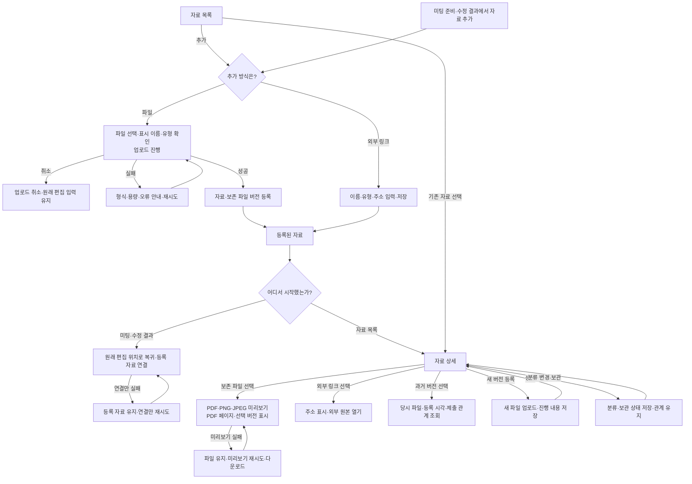

- 보존 버전은 당시 파일을 유지한다. 같은 이름의 파일을 올려도 자동 병합하지 않고 기존 자료의 새 버전인지 별도 자료인지 선택한다.
- 미팅 제출 연결은 버전의 별도 관계다. 새 버전 등록으로 과거 미팅·검토가 참조한 버전을 바꾸지 않는다.
- 외부 URL은 과거 본문 보존·자동 동기화를 뜻하지 않는다. 문서 수정의 교수 검토에는 보존 파일·확인 위치를 연결한다.
- 파일·자료 저장과 연결 성공은 구분한다. 미리보기 실패는 파일 저장 실패가 아니며 등록·연결 취소가 원본 삭제를 뜻하지 않는다.

## 7. 개인 수정 결과와 처리 기록

관련 기능: 2.1, 2.4.

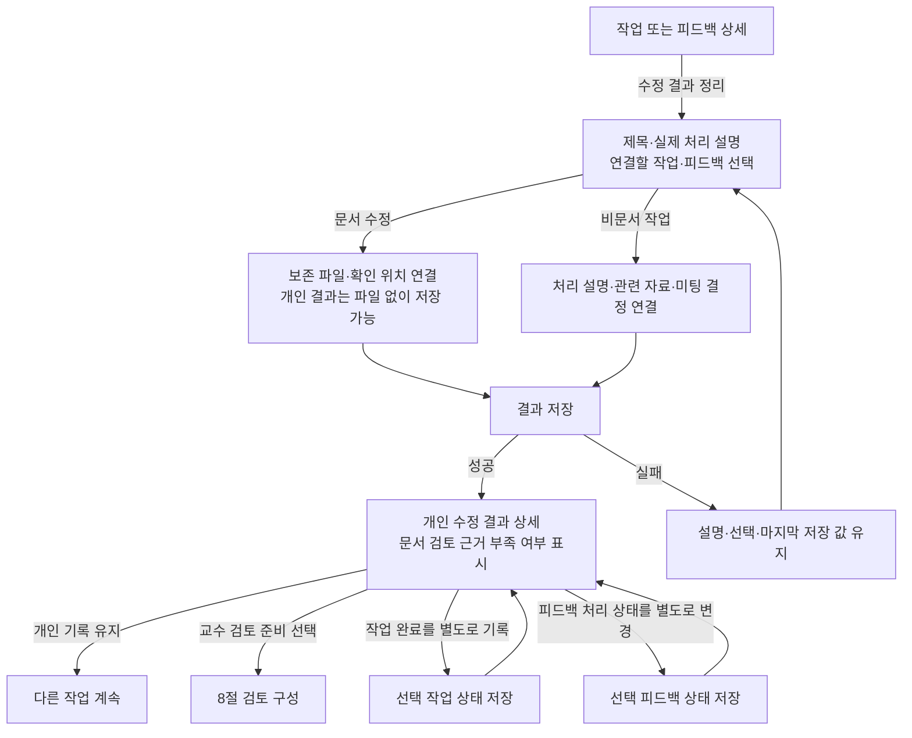

- 실제 수행한 내용만 결과로 남긴다. 결과 저장은 교수 공유·작업 완료·학생 반영 상태를 자동 변경하지 않는다.
- 개인 결과는 보존 파일 없이 저장할 수 있으나 문서 수정 검토 근거가 부족함을 표시한다. 검토 링크 생성 조건은 8절에서 확인한다.
- 같은 결과와 파일을 여러 피드백·작업·검토 항목의 근거로 재사용한다. 이미 공유한 차수의 설명·파일은 개인 결과 편집으로 바뀌지 않는다.

## 8. 검토 구성·공개 미리보기·링크 전달

관련 기능: 1.3, 6.1.

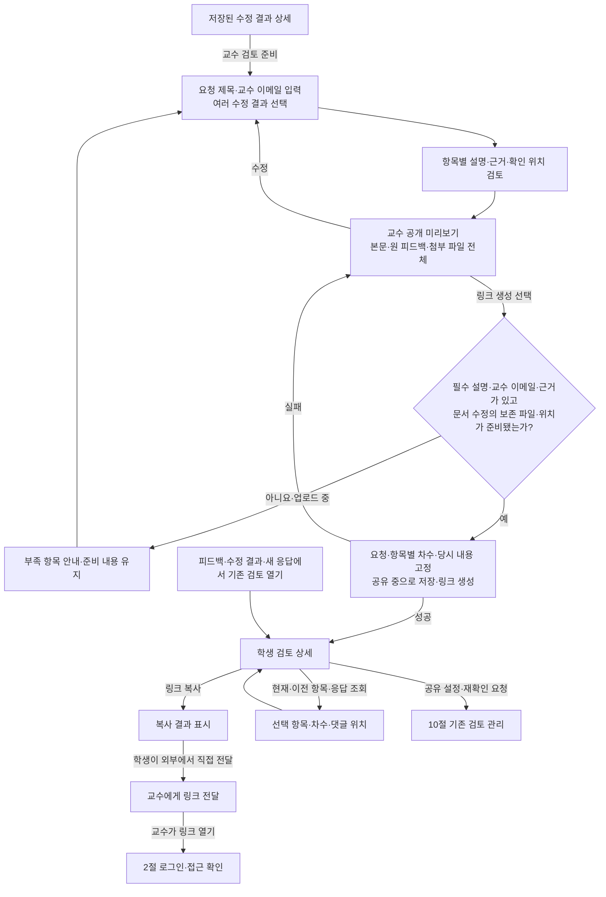

- 링크 생성은 실제 전달·열람·응답과 다르다. 복사 성공도 전달 완료로 표시하지 않는다.
- 미리보기에는 교수에게 공개할 내용을 표시한다. 개인 메모·전체 작업 목록·미채택 AI 후보는 자동 포함하지 않는다. 개인 원문의 전체 열람 권한도 자동 부여하지 않는다.
- 확인 위치를 지정해도 허용 교수는 첨부 파일 전체를 열람·다운로드한다. 일부만 공개하려면 학생이 그 부분으로 만든 별도 파일을 선택한다.
- 준비 중인 요청은 편집한다. 공유 중인 항목의 설명·근거 변경은 10절 재확인 요청으로 새 차수를 만든다. 수정 전 방향을 묻는 별도 질문 입력은 두지 않는다.

## 9. 교수의 항목별 응답과 학생의 후속 행동

관련 기능: 2.2, 7.2.

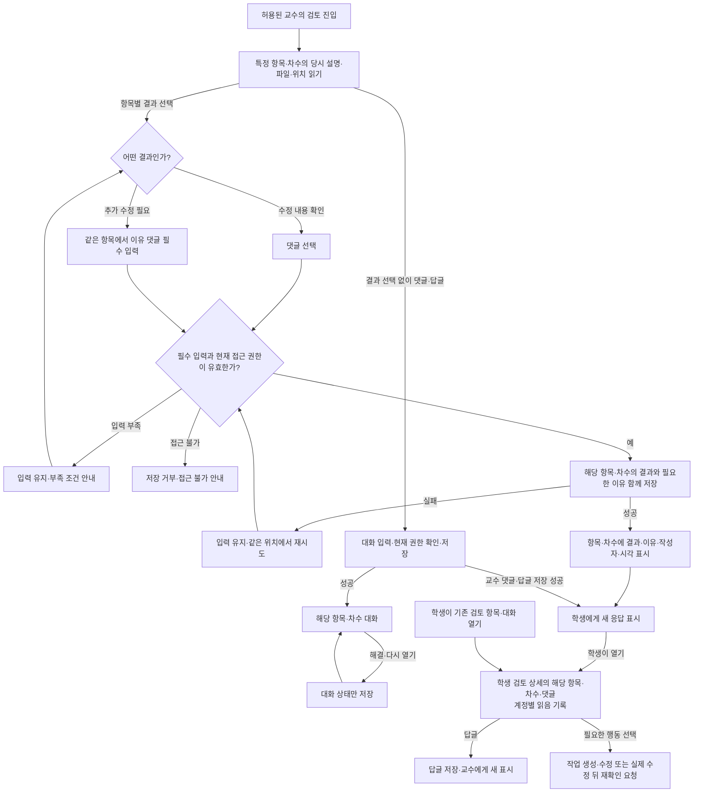

- 추가 수정 필요는 이유 댓글이 공백이면 저장하지 않는다. 수정 내용 확인의 댓글은 선택이다. 결과·필수 이유의 저장이 모두 성공해야 결과 저장 완료로 표시한다.
- 일반 댓글·답글은 결과를 선택하지 않아도 저장한다. 댓글 해결·다시 열기는 교수 결과·학생 처리 상태·작업 상태를 바꾸지 않는다.
- 교수 응답은 해당 항목·차수에만 적용한다. 다른 항목을 응답 완료로 바꾸지 않으며 학생은 교수 결과를 대신 입력·수정하지 못한다.
- 교수는 본인 결과 수정 이력을 남긴다. 추가 수정 필요의 필수 이유를 지우려면 대체 이유가 필요하다.
- 학생은 응답을 읽고 다음 행동을 선택한다. 읽음은 이해·반영·교수 확인이 아니며 추가 수정 필요도 과거 학생 반영 이력을 지우지 않는다.

## 10. 항목별 재확인과 공유 설정

관련 기능: 2.5, 6.1.

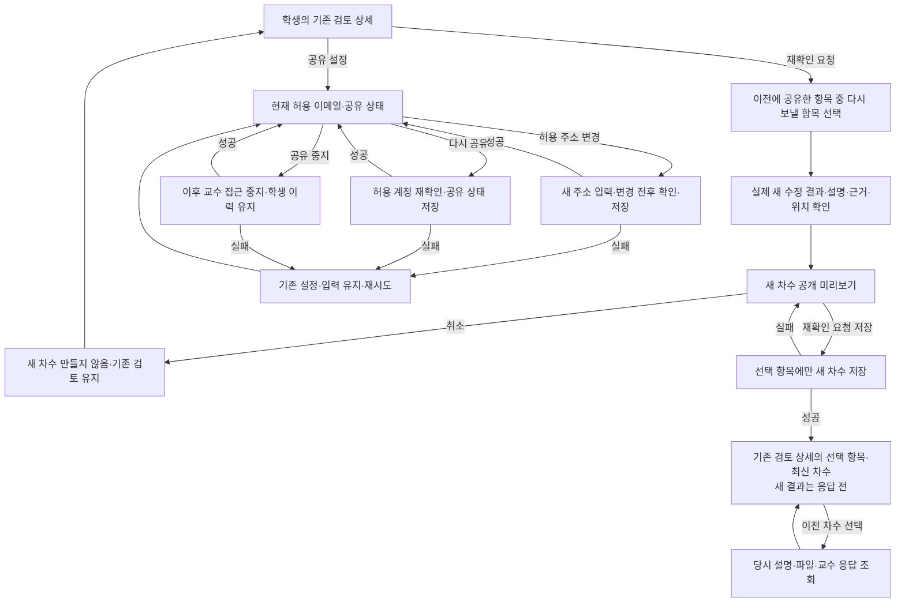

- 새 파일 등록·개인 결과 편집만으로 재확인 차수를 만들지 않는다. 이전 자료·설명·응답과 변경하지 않은 다른 항목의 교수 결과는 유지한다.
- 같은 링크에서 최신·이전 차수를 여는 것은 현재 작성 기준안이다. 새 요청을 자동 생성하거나 전체 항목을 응답 전으로 되돌리지 않는다.
- 이전 차수에서 늦게 저장한 응답은 그 차수에 연결하고 최신 차수의 결과를 덮어쓰지 않는다.
- 재확인 차수와 공유 상태는 구분한다. 공유가 중지된 요청은 새 차수 저장만으로 교수 접근을 다시 허용하지 않는다.
- 주소 변경·공유 중지 뒤에는 이미 열린 화면에서도 파일 열기·다운로드·댓글·응답 저장 시 현재 권한을 다시 확인한다. 이전 응답의 작성자와 당시 자료는 유지한다.
- 공유 중지는 보관·영구 삭제와 다르며 이미 내려받은 사본까지 회수하지 않는다.

## 11. 로드맵과 주요 일정 직접 관리

관련 기능: 5.1~5.2.

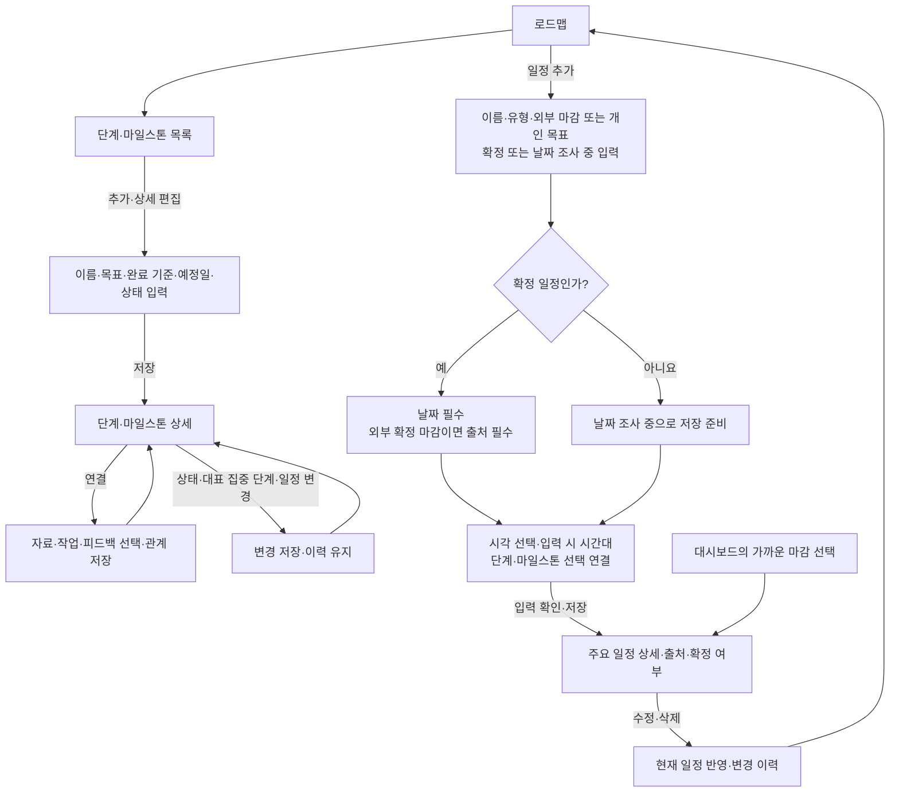

- 단계·마일스톤의 준비 전·진행 중·완료는 학생이 직접 관리한다. 여러 단계의 작업을 병행하거나 완료 후 다시 진행할 수 있다.
- 작업 완료 개수·가이드 확인·교수 결과로 연구 단계를 자동 완료하지 않는다. 종료 예정일이 시작 예정일보다 이른 구간은 저장하지 않는다.
- 날짜 조사 중 저장은 현재 작성 기준안이다. 시각이 없으면 시각 미확인으로 표시하고 23:59를 채우지 않는다. 시각을 입력하면 시간대를 함께 기록한다.
- 개인 목표일 변경으로 공식 마감을 바꾸지 않는다. 일정 저장은 다른 단계·작업 기한을 자동 변경하지 않는다.
- 단계 상세·직접 편집은 초기 기능이다. 준비 가이드와 일정 역산·재조정은 13절 후속 범위다.

## 12. 기본 목록 찾기와 새 응답 표시

관련 기능: 7.1~7.2.

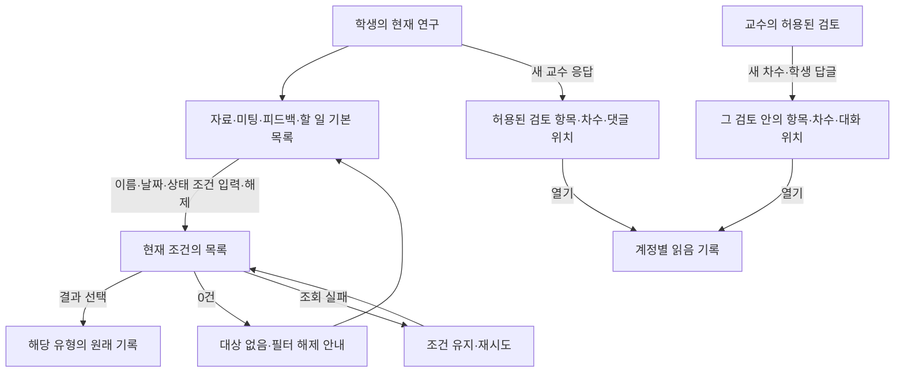

- 학생의 새 응답은 학생 검토 상세로, 교수의 새 표시는 허용된 검토 안으로 이동한다. 교수에게 학생 대시보드나 연구 전체 알림을 노출하지 않는다.
- 남은 작업 요약은 해당 작업·준비 목록, 질문 요약은 해당 질문·미팅, 가까운 마감은 해당 일정 상세를 연다.
- 알림 목록을 별도 화면으로 둘지는 작성 기준안이다. 초기 요구는 서비스 안의 새 표시와 정확한 대상 위치 이동이다.
- 읽음은 반영·작업 완료·교수 확인을 바꾸지 않는다. 현재 권한이 없는 제목·발췌·건수는 목록과 새 표시에서도 노출하지 않는다.

## 13. 후속 기능

관련 기능: 1.4, 3.1, 5.3~5.4, 8.5. 아래 점선 경로는 초기 사용의 선행조건이 아니다.

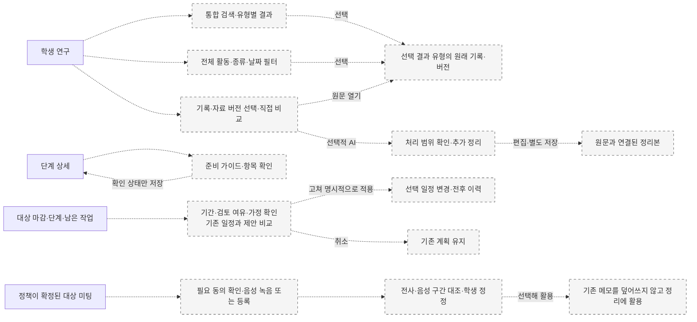

| 기능 | 유지할 동작·예외 |
|---|---|
| 통합 검색·전체 활동 | 현재 권한으로 제목·메타정보·기록을 조회하고 선택한 원래 유형으로 이동한다. 파일 본문 OCR·외부 URL 본문 수집은 검색 대상에 넣지 않는다. 검색 결과 없음·활동 없음·조회 실패를 구분한다. 교수에게 연구 전체 활동을 공개하지 않는다. |
| 기록 비교·추가 AI 정리 | 직접 비교만 해도 된다. AI 실행 때만 처리 범위를 확인하고 실패해도 직접 비교·입력을 유지한다. 저장한 정리본은 원문을 바꾸지 않으며 각 원본 버전으로 이동한다. |
| 준비 가이드 | 해당 단계의 안내·학생 확인을 저장한다. 확인 표시가 연구 단계 완료는 아니다. |
| 일정 역산·재조정 | 예상 기간·가정·부족 기간을 표시한다. 적용 전에는 현재 계획을 바꾸지 않으며 공식 마감은 자동 이동하지 않는다. 일부 적용 실패 시 기존 계획을 복구하거나 미적용 상태를 유지한다. |
| 녹음·전사 | 동의·보존·삭제·외부 처리 정책이 확정된 뒤 제공한다. 거부·파일 오류·전사 실패에도 직접 메모를 계속한다. 부분 전사·학생 정정·화자 추정을 구분하며 교수 직접 확인으로 표현하지 않는다. |

## 예외 상황 (메인 시나리오 기준)
> 2026-11-16 추가. 메인 시나리오([PRD](prd.md#메인-시나리오-사용성-테스트-과업))를 한 단계씩 따라가며 계획대로 진행되지 않는 경우와 화면이 알려 줄 다음 행동을 정한다.

| 단계 | 상황 | 화면에 보여 줄 것 | 다음 행동 |
| --- | --- | --- | --- |
| 미팅 메모에서 피드백 고르기 | 빈 상태: 메모가 없는 미팅 | “아직 기록이 없어요”와 기록 방법 | 메모 쓰기 · 녹음하기 |
| 기록 불러오기 | 오류: 서버·네트워크 문제로 실패 | “기록을 불러오지 못했어요” (빈 상태와 다른 화면) | 다시 불러오기 |
| 수정 방법 정하기 | 로딩: AI 제안이 10초 넘게 걸림 | 지금 단계, 지난 시간과 보통 걸리는 시간, 화면을 떠나도 계속되는지 | 기다리기 · 중단 · 직접 작성 |
| 수정 방법 정하기 | AI 오류: 그럴듯하지만 원문과 다른 제안 | 원문 인용과 ‘확인이 필요한 가정’을 나눠 표시, 인용이 원문에 없으면 적용하지 않음 | 그 자리에서 고치기 · 다시 제안받기 · 직접 작성 |
| 수정 방법 정하기 | AI 미연결 | “연구 도우미가 아직 연결되지 않았어요” (가짜 결과 없음) | 직접 작성 |
| 할 일로 만들기 | 입력 오류: 이름이 비어 있음 | 칸 바로 아래 이유, 그 칸으로 초점 이동 | 이름 쓰기 |
| 수정 결과 기록 | 업로드 실패·중단 | 실제 진행률, 실패 이유 | 다시 시도 |
| 검토 요청 만들기 | 보낼 수정 결과가 없음 | 빈 상태와 수정 결과 만들기 안내 | 수정 결과 만들기 |
| 링크 만들기 | 요청 실패 | 실패 이유, 입력은 그대로 | 다시 시도 |

버튼 이름 기준: 불러오기에 실패하면 ‘다시 불러오기’, 사용자가 한 요청이 실패하면 ‘다시 시도’.

## 14. 공통 저장·취소·실패 처리

관련 기능: 기능명세서의 프로덕트 정책.

| 상황 | 처리 |
|---|---|
| 필수 입력 없음·공백 | 저장하지 않고 해당 입력을 안내한다. 선택 입력은 비워도 저장한다. |
| 메모 작성 | 자동 저장하며 저장 중·저장됨·실패를 표시한다. |
| 작업·수정 결과·교수 응답·권한 변경 | 명시적 저장 성공 뒤 현재 상세·목록에 반영한다. |
| 저장 실패 | 입력과 마지막 저장 값을 유지한다. 같은 위치에서 재시도하며 성공으로 표시하지 않는다. |
| 저장 성공·연결 실패 | 원본은 유지하고 연결만 재시도한다. 중복 선택·재시도로 같은 기록을 여러 개 만들지 않는다. |
| 미저장 입력을 두고 이동 | 계속 편집 또는 버리고 이동을 선택하게 한다. 자동 저장 실패를 조용히 무시하지 않는다. |
| 다른 창에서 변경 | 알리지 않고 덮어쓰지 않으며 최신 상태와 미저장 입력을 확인한다. |
| 권한 변경 | 화면·파일 열기·다운로드·댓글·응답 저장 때 현재 권한을 확인한다. |
| AI 실행 | 선택한 메모·자료 버전·구간을 실행 전에 보여준다. 교수 공유 동의와 구분한다. |
| AI 실패·생성 중단 | 원문·학생 입력·기존 작업을 유지하고 직접 작성을 계속한다. 외부에서 이미 처리한 내용까지 소급 취소했다고 표현하지 않는다. |
| AI 영역 닫기 | 입력·후보를 유지한다. 생성 중단과 별도 행동으로 취급한다. |
| AI 방안 채택 취소 | 연결 작업·수정 결과를 자동 삭제하지 않고 기존 관계 유지·해제를 선택한다. |
| 조회 | 대상 없음·검색 결과 없음·불러오기 실패·접근 불가를 구분한다. |

작업 완료, 학생의 피드백 처리 상태, 교수의 항목별 결과, 질문 해결, 댓글 대화 해결, 읽음은 각각 별도 기록이다. 한 상태를 변경했다고 다른 상태를 자동 변경하지 않는다.
